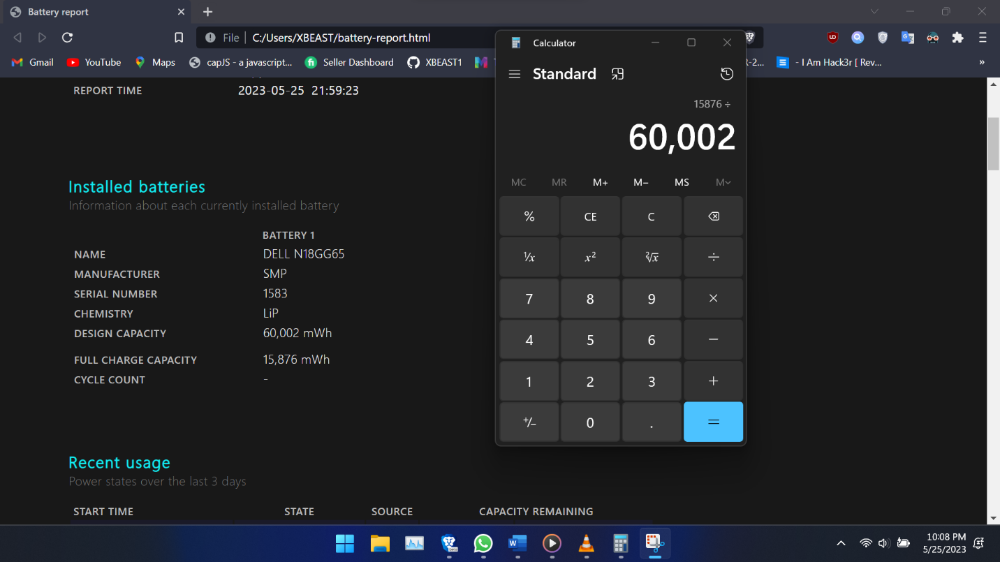
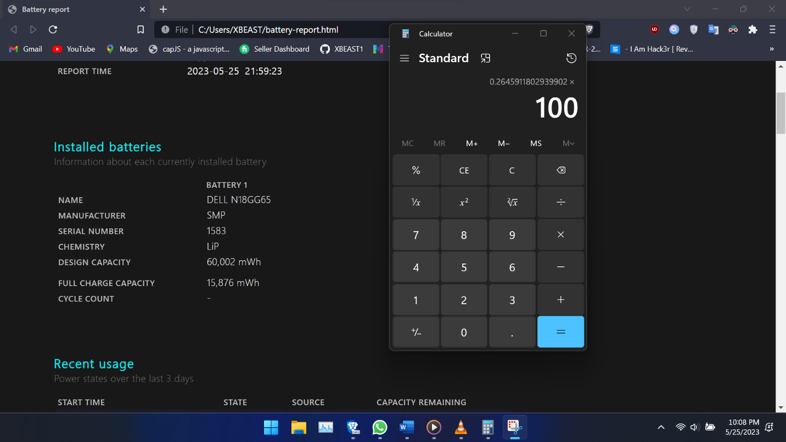
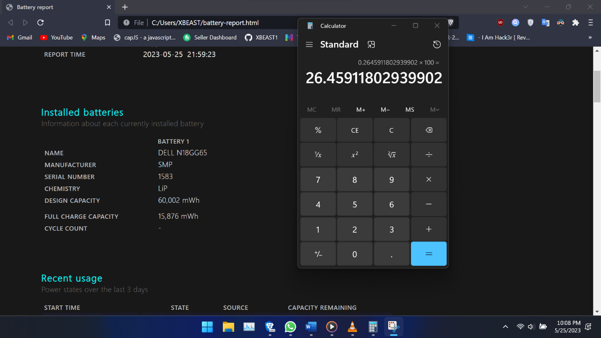

# Universal Used Laptop Buying & Inspection Guide

A structured, beginner-friendly inspection checklist for buying used, refurbished, or open-box Windows laptops in local computer shops or marketplaces.

**Companion Diagnostic Suite:** Pre-loaded portable utilities available in [`Softwares/`](Softwares/)

> [!TIP]
> **Offline Use:** Press **`Ctrl + P`** (Windows / Linux) or **`Cmd + P`** (macOS) in your web browser to save this guide as an offline PDF for in-shop testing.

---

## ⚡ Quick In-Shop Inspection Protocol (15–20 Minutes)

When testing a used laptop on a shop counter, execute checks in this sequence:

| Step | Test Area | Tool Used | Target Metric | Walk-Away Red Flag |
| :--- | :--- | :--- | :--- | :--- |
| **1** | **Physical Chassis** | Visual & Tactile | Tight screws, zero chassis flex | Stripped screws, swollen frame, cracked hinge |
| **2** | **Screen & Pixels** | Dead Pixel Buddy | Uniform color, zero stuck pixels | Stuck colored pixels, heavy backlight bleed |
| **3** | **Ports & Charger** | USB Drive / Charger | Solid connection, no play | Loose Type-C, non-functioning display output |
| **4** | **Storage Health** | CrystalDiskInfo | NVMe `0E` = 0; SATA `05`/`B7` = 0 | Health below 70%, reallocated sectors |
| **5** | **Storage Speed** | CrystalDiskMark | Meets PCIe 3.0 / 4.0 rated speed | Speeds throttled below 200 MB/s |
| **6** | **Battery Health** | `powercfg /batteryreport` | 80% or higher remaining health | Battery health below 60%, instant drop on load |
| **7** | **Keyboard & Pad** | Key-Test RU | All keys register, smooth click | Sticky keys, dead zones, failed click pad |
| **8** | **Wireless** | Phone Hotspot | Fast 2.4 GHz & 5 GHz connection | Dropping connection, Bluetooth pairing failure |
| **9** | **CPU & Thermals** | FurMark / CPU-Z | Sustained under 85°C on full load | Instant jump above 90°C, thermal throttling BSOD |
| **10** | **Webcam & Audio** | Camera App / Mic | Clear image, responsive audio bar | Cracked lens, non-functional IR sensor |

---

## 1. Physical Body & Chassis Inspection

Before powering on the laptop, inspect the exterior hardware thoroughly:

1. **Chassis & Panels:** Check the top lid, keyboard deck, and base plate for cracks, deep dents, or structural bending. Minor cosmetic scratches are normal, but dents near corners indicate heavy drops that can damage internal motherboards.
2. **Bottom Screws:** Examine all bottom panel screws. Every screw head should have sharp, undamaged grooves. Stripped, chewed-out, or missing screws indicate previous repair work, botched thermal paste replacements, or third-party tampering.
3. **Hinge Tension:** Open and close the laptop lid slowly across multiple angles (30°, 45°, 90°, and 120°). The hinge should move smoothly with consistent resistance without cracking noises or chassis separation near the base.
4. **Chassis Swelling Check:** Lay the laptop flat on a level table. If the rubber feet do not touch the surface evenly, or if the keyboard deck curves upwards around the touchpad, the internal lithium battery is likely swollen and requires immediate rejection.

---

## 2. Screen Quality & Dead Pixel Inspection

Display replacements on used laptops are common and often use cheap, low-resolution aftermarket panels with poor color accuracy.

1. **Dead Pixel Testing:**
   * Launch `Dead Pixel Buddy.exe` from [`Softwares/`](Softwares/).
   * Cycle through full-screen white, black, red, green, and blue backgrounds.
   * On black screens, look for bright stuck pixels (red, green, or blue).
   * On white screens, look for dark dead pixels or dirty spots caused by backlight diffuser damage.
2. **Backlight Bleeding:** Set screen brightness to maximum and view a pure black background in a dimly lit area. Uneven patches of bright white light leaking from the corners indicate physical frame pressure or a damaged panel.
3. **Viewing Angles & Color Shift:** Tilt the display backward and forward. Modern IPS and OLED panels retain clarity from wide angles. If the screen washes out or inverts colors when viewed from a slight angle, the laptop has a budget TN panel.
4. **Hinge Flex Cable Test:** While a pure white screen is displayed, slowly move the lid back and forth between 45° and 130°. If the display flickers, shows horizontal lines, or dims temporarily, the internal eDP display ribbon cable is pinched or failing.

---

## 3. Port & Connector Integrity

Test every physical port on both sides of the laptop chassis:

1. **USB Type-A & Type-C:** Plug in a fast USB flash drive into every single port. For every Type-C port (data or Thunderbolt), plug the drive or cable in, confirm detection, then flip the connector 180 degrees and plug it back in. Both sides and orientations must work flawlessly without requiring you to wiggle or hold the connector at an angle.
2. **Charging Port & Reversible Type-C:** If the laptop charges via USB-C, plug the charging cable in, confirm the charging icon appears, then flip the cable 180 degrees and plug it back in. Both orientations must negotiate charging properly.
3. **Display Outputs (HDMI / DisplayPort):** If a monitor is available in the shop, connect to the HDMI or Type-C display output to confirm external display handshakes work.
4. **Headphone Jack:** Insert a 3.5 mm headset and verify left and right channels output clear audio without crackling or static.

---

## 4. Storage Drive Health (CrystalDiskInfo)

Verify the operational health of internal SSDs or HDDs using `crystaldiskinfo-9-5-0.exe` from [`Softwares/`](Softwares/):

* **Solid State Drives (SSD):**
  * **New / Open-Box Units:** Health must be 100%.
  * **Used Laptops:** Health should be 80% or higher. Anything below 70% indicates significant NAND flash wear.
  * **Critical Raw Error Counts:** Ensure NVMe `0E` (Media and Data Integrity Errors) or SATA `05`/`B7` (Bad Blocks) are strictly 0.
* **Mechanical Hard Drives (HDD):**
  * If the laptop uses a secondary mechanical HDD, its SMART health must be 100% "Good". Attributes `05` (Reallocated Sectors), `C5` (Pending Sectors), and `C6` (Uncorrectable Sectors) must be strictly 0. Any non-zero count means mechanical degradation.

---

## 5. Storage Speed Benchmarking (CrystalDiskMark)

Counterfeit, degraded, or overheating laptop drives often report "Good" in SMART telemetry while throttling heavily during real read and write workloads.

### Targeted 1-Pass Sequential Burst Test (30 Seconds)

Launch `CrystalDiskMark8_0_4c.exe` from [`Softwares/`](Softwares/).

> [!WARNING]
> Never click the green **"All"** button or run default 5-pass benchmarks on used laptops at a shop counter. The default test writes 20 to 40 GB of data, overheats uncooled internal laptop M.2 slots, and wastes valuable testing time.

Execute this targeted sequential burst test instead:
1. **Set Test Passes:** Change `5` to **`1`**.
2. **Set Test Size:** Select **`1 GiB`**.
3. **Run Sequential Test:** Click **ONLY the top `[SEQ1M Q8T1]` button** (Sequential Read and Write test at 1 Megabyte block size, Queue Depth 8, 1 Thread).

| Storage Interface | Target Sequential Read Speed | Target Sequential Write Speed | Diagnostic Note |
| :--- | :--- | :--- | :--- |
| **SATA III SSD (2.5" / M.2)** | 500 MB/s to 550 MB/s | 450 MB/s to 520 MB/s | Speeds below 250 MB/s indicate degraded NAND flash or a failing SATA controller. |
| **PCIe Gen 3 NVMe SSD** | 2,000 MB/s to 3,500 MB/s | 1,200 MB/s to 3,000 MB/s | Common in 8th to 10th Gen Intel and Ryzen 3000/4000 laptops. |
| **PCIe Gen 4 NVMe SSD** | 4,500 MB/s to 7,000 MB/s | 3,800 MB/s to 6,500 MB/s | Standard in 11th Gen+ Intel and Ryzen 5000+ laptops. |
| **Mechanical HDD (2.5")** | 100 MB/s to 140 MB/s | 90 MB/s to 130 MB/s | Speeds collapsing below 40 MB/s indicate surface defects or failing read heads. |

> [!TIP]
> **Post-Stress SMART Refresh:** After the sequential burst test completes, switch back to CrystalDiskInfo and press **`F5`** to refresh. If NVMe `0E` (Media Errors) or SATA `05`/`B7` (Bad Blocks) increments by even 1, the drive has active cell degradation under load and should be rejected.

---

## 6. Battery Health & Capacity Calculation

Windows includes a built-in battery diagnostic tool that calculates true battery wear and charge history.

### Generating the Report

1. Press `Windows Key + R`, type `cmd`, and press Enter.
2. In the terminal window, execute:
   ```cmd
   powercfg /batteryreport
   ```
3. Windows saves an HTML report to your user profile directory, for example:
   ```text
   C:\Users\YourUsername\battery-report.html
   ```
4. Open the generated file in your web browser.

### Calculating Real Health Percentage

Scroll down to the **Installed batteries** section and locate two key values:
* **Design Capacity:** The factory capacity when the battery was new.
* **Full Charge Capacity:** The maximum charge the battery can currently hold.





Now divide Full Charge Capacity by Design Capacity and multiply by 100:

$$\text{Battery Health (\%)} = \left( \frac{\text{Full Charge Capacity}}{\text{Design Capacity}} \right) \times 100$$



* **Example Calculation (From Screenshots Above):**
  $$\text{Full Charge Capacity} = 15,666\text{ mWh}$$
  $$\text{Design Capacity} = 60,002\text{ mWh}$$
  $$\text{Health} = \left( \frac{15,666}{60,002} \right) \times 100 = 26.1\%$$
* **Verdict:** A battery health of 26% means the battery is severely degraded and will only last 20 to 30 minutes off the charger.
* **Shop Evaluation Guidelines:**
  * **90% or higher:** Excellent condition.
  * **75% to 89%:** Normal used condition with modest cycle wear.
  * **Below 60%:** Heavily worn battery; factor the price of a replacement battery pack into your purchase offer.

---

## 7. Keyboard & Touchpad Integrity

Laptop keyboards often suffer from soda spills, worn silicone domes, and unseated ribbon cables.

1. **Full Key Matrix Test:**
   * Open the online keyboard tester at [en.key-test.ru](https://en.key-test.ru/).
   * Press every single key across the keyboard, including Function keys (`F1`–`F12`), arrow keys, `Shift`, `Ctrl`, and the Spacebar.
   * Every key should turn green on first press. Sticky keys or keys that require heavy downward pressure indicate liquid spill residue.
2. **Text Ghosting Check:** Open Notepad and type rapidly. Verify that no key produces double letters (key chatter) or skips characters.
3. **Keyboard Backlight:** Press the keyboard backlight shortcut key. Confirm that all key legends illuminate evenly without dark sections.
4. **Touchpad Surface & Gestures:**
   * Slide your finger smoothly across the entire trackpad area, including edges and corners. Ensure the cursor tracks without stuttering.
   * Test physical clicks on the bottom-left and bottom-right corners. The mechanical click should feel crisp, not mushy.
   * Verify multi-finger gestures: two-finger vertical scrolling and three-finger app switching.

---

## 8. Wireless Connectivity (Wi-Fi & Bluetooth)

A damaged internal Wi-Fi antenna will show full signal right next to the shop router, but drops completely when you move 15 feet away.

1. **Hotspot Range Test:**
   * Enable the Wi-Fi hotspot on your smartphone and connect the laptop to it.
   * Step 15 to 20 feet away from the phone. The Wi-Fi connection should remain stable and continue loading web pages without dropping to zero bars.
2. **Dual-Band Verification:** Confirm the laptop sees and connects to both 2.4 GHz and 5 GHz networks.
3. **Bluetooth Audio & File Transfer:** Enable Bluetooth, pair your wireless earbuds or phone, and verify stable audio playback or file transfer without stuttering.

---

## 9. CPU Stress Testing & Thermal Dissipation

Used laptops often suffer from dried-out factory thermal paste, clogged heatsink fins, or dead cooling fans.

1. **Monitoring Setup:** Launch `hwi64_816.exe` (HWiNFO64) from [`Softwares/`](Softwares/) and open the **Sensors** view. Keep CPU Core temperatures visible.
2. **Running the Load:**
   * Launch FurMark CPU Burner (or CPU-Z Stress Test).
   * Run the multi-threaded CPU stress test for 3 to 5 minutes.
3. **Evaluating Thermal Behavior:**
   * **Under 80°C:** Outstanding cooling performance.
   * **80°C to 85°C:** Normal sustained thermal behavior for slim laptops under 100% load.
   * **Instant Jump Above 90°C:** If temperatures spike past 90°C within 5 seconds of starting the test, the thermal paste is completely dried out or the heat pipe has lost its vacuum seal.
   * **Thermal Throttling & Shutdown:** If the laptop thermal-throttles down to low clock speeds, locks up, or shuts off abruptly, walk away immediately.
4. **Fan Bearing Check:** Listen to the cooling fans spin up to maximum RPM. They should emit a smooth whoosh of air. Any grinding, rattling, or high-pitched whining indicates failing sleeve bearings.

---

## 10. Webcam, Microphones & Infrared Sensors

1. **Physical Lens Check:** Inspect the webcam lens at the top of the display bezel. Ensure there are no cracks, deep scratches, or internal condensation.
2. **Video & Microphone Test:** Open the Windows Camera app. Verify crisp video capture and check that the microphone recording volume bar in Windows Sound Settings responds cleanly when speaking at a normal conversational volume.
3. **Windows Hello IR Sensor:** If the laptop supports facial recognition, verify the infrared sensor is functioning. If Windows 11 drivers fail to activate the IR sensor during test, run a live Linux USB environment with the Cheese camera utility to confirm hardware detection.

---

## 11. Walk-Away Red Flags Summary

Never buy a used laptop if you encounter any of the following critical defects:

* **Swollen Chassis or Trackpad:** Lithium battery swelling is a fire hazard and warps the motherboard.
* **Stripped or Missing Chassis Screws:** Clear evidence of amateur repairs or missing components.
* **Instant Thermal Spike Above 90°C:** Failed cooling assembly or degraded heat pipes.
* **SMART Storage Bad Blocks:** NVMe `0E` count or SATA `05`/`B7` count greater than 0.
* **Display Flickering During Hinge Movement:** Damaged eDP ribbon cable requiring delicate screen disassembly.
* **BIOS / Firmware Password Lock:** If entering BIOS requires a password that the seller cannot provide, the laptop may be stolen corporate property with locked firmware.

---

**Hardware Buying & Maintenance Guides**  
Authored by **M. Hamza** ([@XBEAST1](https://github.com/XBEAST1)). For the latest updates, companion component guides, and contributions, visit the [GitHub Repository](https://github.com/XBEAST1/Hardware-Buying-Guides).

