# Universal Used Mobile Phone Inspection Guide (Google Pixel Focus)

A comprehensive, beginner-friendly inspection checklist for buying used, refurbished, and kit-packed smartphones, with specialized diagnostic procedures and carrier model matrices for Google Pixel devices.

> [!TIP]
> **Need an Offline Copy?** Download the official printable [**Mobile-Buying-Guide.pdf**](https://github.com/XBEAST1/Hardware-Buying-Guides/releases/latest) from the latest release to keep on your phone or USB drive.

---

## ⚡ Quick In-Shop Inspection Protocol (15–20 Minutes)

When evaluating a used mobile phone on a shop counter, execute checks in this sequence:

| Step | Test Area | Method | Target Standard | Walk-Away Red Flag |
| :--- | :--- | :--- | :--- | :--- |
| **1** | **Dialer Code** | `*#*#7287#*#*` | Built-in test suite passes | Hardware sensor failure, blocked diagnostics |
| **2** | **Chassis & Back** | Edge & Seam Pressure | Flush glass, clean antenna bands | Spongy back cover, glue residue, China stickers |
| **3** | **Water Resistance** | SIM Tray Breath Test | Air sealed tight inside chassis | Air leaks freely through seams or speaker grill |
| **4** | **Display Quality** | White Screen & Icon Drag | Zero ghosting, uninterrupted drag | Thick bezels, off-center camera hole, touch drops |
| **5** | **Camera Optics** | Light Angle & Flash Test | Green anti-reflective lens tint | Dust inside lens, missing green tint, black spots |
| **6** | **Battery & Port** | 4K 60fps Video & Port Check | 1% to 2% drop in 2–4 mins | Excessive battery drop, one-sided Type-C failure |
| **7** | **IMEI & Legal** | SIM Tray vs `*#06#` | Matches tray, Clean status | Mismatched IMEI, Verizon locked, blacklisted |
| **8** | **OEM Unlocking** | Developer Options | Toggle selectable (blue / active) | "OEM Unlocking" greyed out (locked bootloader) |

---

## 📞 Google Pixel Secret Diagnostic Code

Connect the phone to Wi-Fi or cellular data, open the Phone Dialer app, and enter:

```text
*#*#7287#*#*
```

This secret dialer sequence opens Google Pixel's autonomous hardware testing menu to test display touch, proximity sensors, front/rear cameras, microphone arrays, and audio drivers directly from Google's diagnostic service.

---

## 1. Physical Body & Refurbished Back Inspection

1. **Front Screen Seams:** Gently press along the perimeter where the display glass meets the metal frame. If you feel any spongy movement, wobble, or light bleed along the borders, the screen is an aftermarket replacement.
2. **Back Cover Seams:** Press around the edges of the rear glass. If the back panel yields, feels squishy, or reveals adhesive residue, the phone has been opened to replace the battery or internal components.
3. **Antenna Signal Cuts:** Inspect the plastic antenna bands embedded in the metal outer frame. Original factory frames feature smooth, laser-cut joints.

   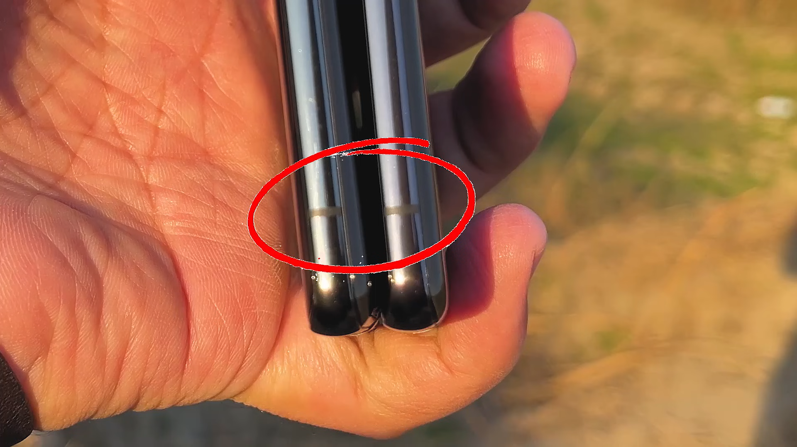

4. **Refurbished Rear Glass Tint:** Aftermarket replacement back covers often show incorrect color shifts. On devices like the Pixel 7 Pro, cheap refurbished back covers display an off-color brownish or yellowish tint under fluorescent store lighting.

   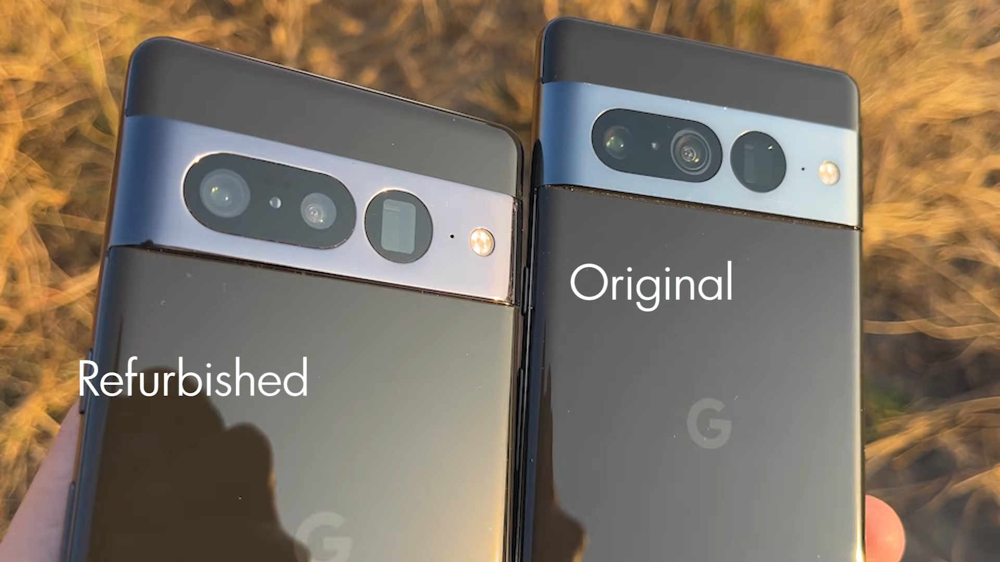

5. **China Refurbished Stickers vs. Original Factory Seals:**
   * **Refurbished / Repacked Phones:** Almost all refurbished units imported in bulk feature a small Chinese inspection label or QC sticker across the back glass or camera visor.
   * **Original Paper Kit Phones:** Authentic factory kit units may carry an official shop warranty sticker, but they never feature Chinese market factory stickers.

   | Refurbished China Sticker | Authentic Unit Inspection |
   | :---: | :---: |
   | 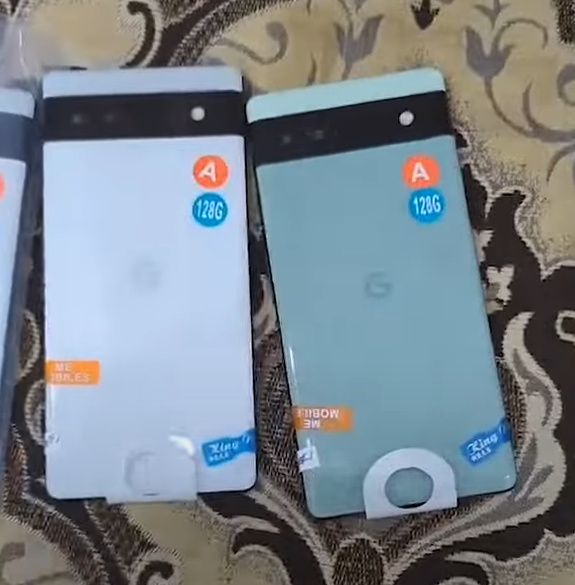 | 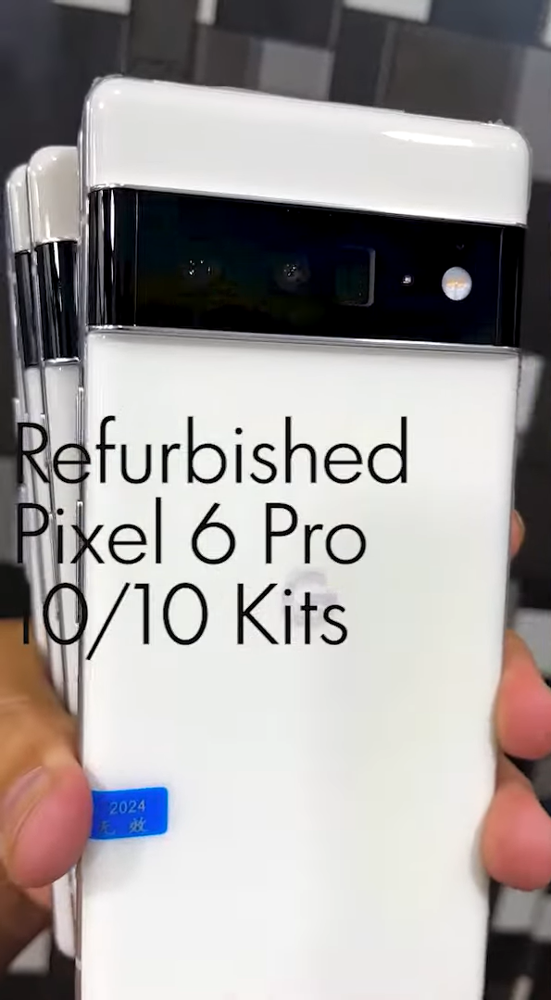 |

6. **Gorilla Glass Oleophobic Coating Test:**
   * Wipe a clean cloth or your thumb across the rear glass panel.
   * Authentic Corning Gorilla Glass features an oleophobic coating that clears fingerprints and oils almost immediately.
   * Aftermarket plastic or untreated glass replacement backs hold onto oily smudges, resist cleaning, and display distorted light reflections.

   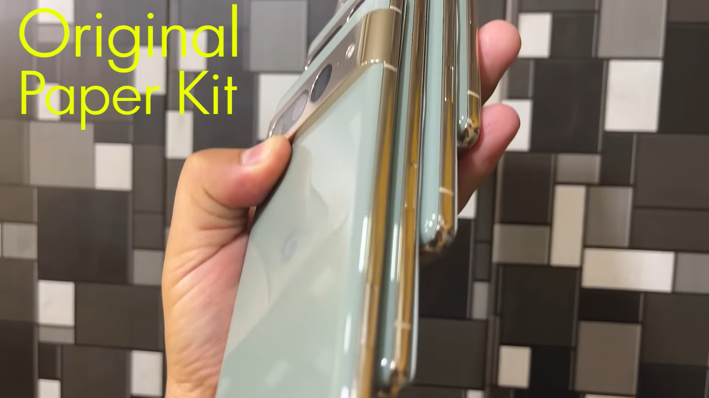

   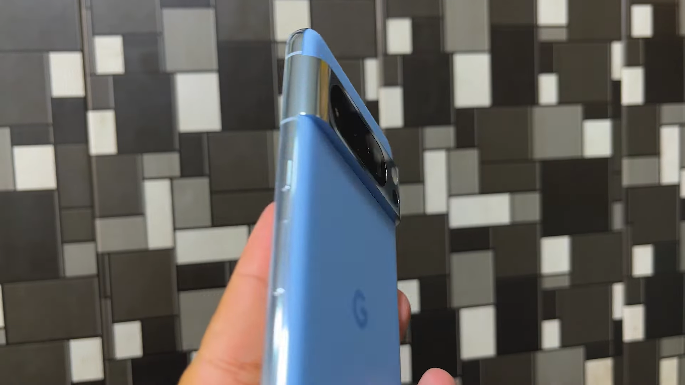

   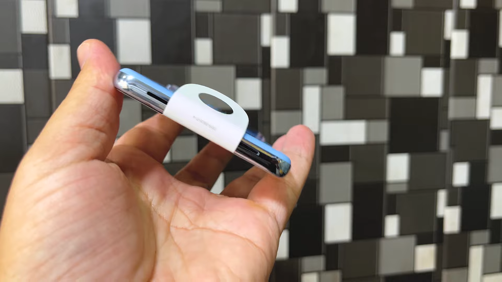

---

## 2. Water-Pack Seal & Speaker Grill Inspection

Factory water resistance (IP68) guarantees that the phone's factory adhesives are intact and the device has never been opened.

1. **The SIM Tray Breath Test:**
   * Eject the SIM card tray.
   * Place your lips over the SIM slot opening and gently blow air inside while holding your fingers close around the display seam, rear glass seam, and camera visor.
   * **Sealed Phone:** You will feel strong backpressure resisting your breath, and no air will escape around the edges.
   * **Opened / Resealed Phone:** Air will leak freely through the speaker grill, microphone holes, or perimeter glass seams.
2. **Speaker Grill Mesh Inspection:** Inspect the bottom acoustic mesh ports under bright light. Authentic Google Pixel speaker grills are smooth, uniform, and water-sealed. Refurbished or opened units often feature torn, punctured, or frayed mesh grills.

   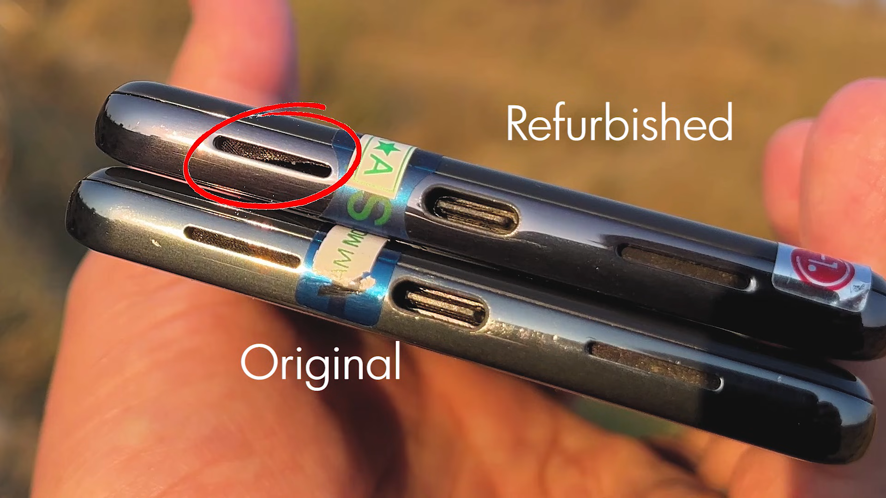

---

## 3. Display Quality, Bezels & Touch Grid

1. **Brightness & Ghosting (OLED Burn-In):**
   * Switch the phone theme to pure white and set brightness to 100%.
   * Inspect the notification bar area and navigation bar area for faint shadows (e.g., permanent battery icons, clock numerals, or keyboard outlines burned into the OLED matrix).
2. **Color Uniformity & White Balance:** Look at the screen from multiple angles. Off-white color shifts, greenish tints, or coarse pixelation indicate a budget aftermarket LCD/OLED panel.
3. **Front Camera Punch-Hole Alignment:** Observe the circular hole-punch cutout for the selfie camera. On original displays, the cutout is perfectly centered and tight around the lens. On replacement screens, the hole is often oversized, irregular, or misaligned with the optical sensor.
4. **Bezel Thickness:** Compare the black border (chin and side bezels) with official product images. Aftermarket screens feature noticeably thicker chin bezels due to cheap display driver IC packaging.
5. **Full Touch Matrix Drag Test:**
   * Long-press an app icon on the home screen until it floats.
   * Slowly and methodically drag the icon across every square centimeter of the display in a tight zig-zag pattern, covering every corner and edge.
   * If the icon drops or slips out from under your finger at any point, that specific touch digitizer zone is defective.

   | Dragging App Icon Grid Test | Full Screen Coverage Check |
   | :---: | :---: |
   | 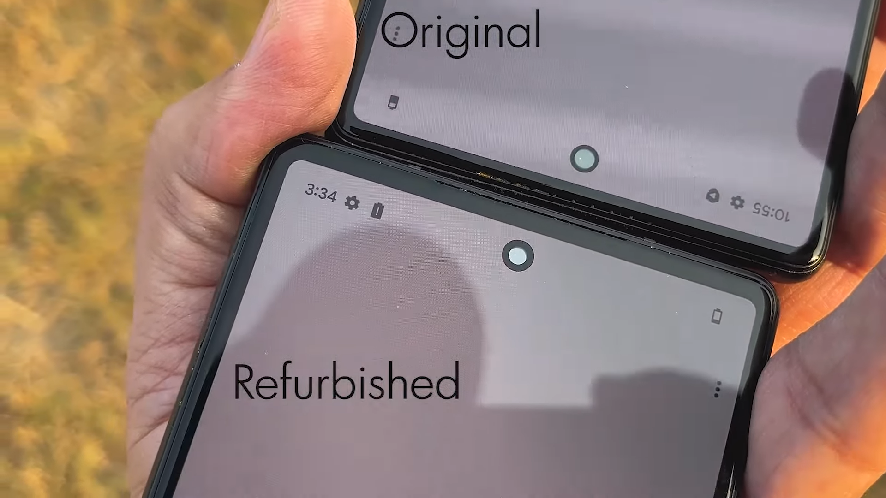 | 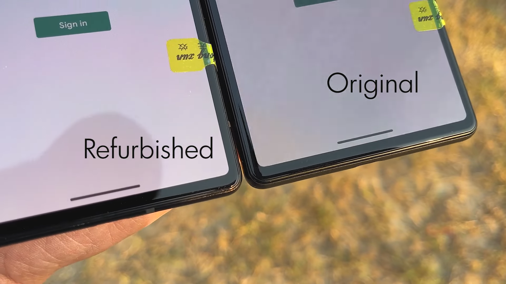 |

---

## 4. Ports, Connectors & Physical Buttons

1. **USB Type-C Port (Reversible Both-Sides Verification):**
   * Plug in a charger and a data transfer cable. Confirm charging and file transfer initiate immediately.
   * **The 180-Degree Flip Test:** Unplug the Type-C cable, flip it upside down (180 degrees), and plug it back in.
   * Both sides and orientations must negotiate fast charging and data transfer with zero wiggling. If the phone only charges or connects on one side, internal CC pins or contact rows are damaged or burnt.
2. **Physical Buttons:** Press the Power button and Volume Up/Down rockers. Buttons must deliver a crisp, tactile click and sit flush with the aluminum frame. Soft, mushy, or sunken buttons indicate frame misalignment or liquid ingress.
3. **Headphone Jack (If Present):** Insert wired headphones 2 to 3 times and verify clean stereo audio output without crackling.

---

## 5. Camera Optics, Anti-Reflective Tint & Sensor Dust

1. **Gorilla Glass Camera Visor:** Tilt the camera visor under overhead light. Factory camera glass is made of hardened glass that resists fine pocket scratches. Heavily scratched visor surfaces indicate cheap plastic replacement covers.
2. **Greenish Anti-Reflective Optical Coating:**
   * Shine a bright flashlight at a 45-degree angle directly onto the rear camera lenses.
   * Original optical assemblies feature a distinct greenish or purple anti-reflective optical coating on the internal lens elements.
   * If the lens looks completely clear like window glass with no colored reflection, the camera module or outer glass has been replaced with cheap non-coated glass, causing severe lens flares in photos.

   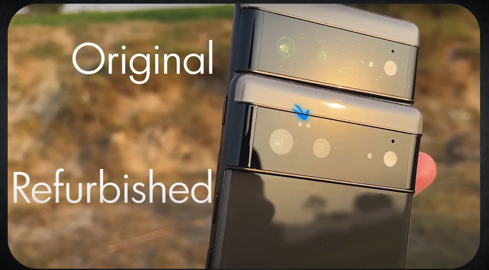

3. **Internal Lens Dust Check:** Inspect the interior lens cavities through the outer glass. If you spot dust particles, lint, or fingerprints inside the lens chamber, the device was opened in an unsealed environment.
4. **Black Spots Sensor Test:** Open the camera app, activate the flashlight, and place your index finger firmly over the main camera lens. The entire preview screen should glow uniformly bright red. If you see dark specks or black circular spots, the CMOS image sensor has permanent physical damage or burnt photodiodes.
5. **Autofocus Speed:** Point the camera at a nearby object (6 inches away), then quickly shift focus to a distant object across the shop. Google Pixel laser/dual-pixel autofocus should lock on instantly without hunting or pulsating.

---

## 6. Speaker Acoustic Balance

1. **Bottom Loudspeaker / Buzzer:** Play a high-bitrate music track at 90% volume. Listen for buzzing, rattling, or metallic distortion caused by cracked speaker membranes or metallic shavings stuck to the magnetic driver.
2. **Top Earpiece Speaker:** Make a test phone call or play audio through the earpiece. The voice must be loud, crisp, and clear without muffled volume.

---

## 7. Sensors & Biometrics

1. **Wi-Fi Dual-Band Range:** Connect to both 2.4 GHz and 5 GHz networks. Confirm signal strength does not drop significantly when stepping away from the router.
2. **Bluetooth Connection:** Pair a set of wireless earbuds and verify uninterrupted audio streaming.
3. **Fingerprint Sensor:** Register your thumbprint. On in-display optical or ultrasonic fingerprint scanners, verify unlock speed both with and without a screen protector. Excessive delays indicate replaced digitizers or uncalibrated biometric sensors.

---

## 8. Battery Health & Charging Port Wear

1. **The 4K Video Drain Stress Test (2–4 Minute Benchmark):**
   * Open the camera app and set video recording to **4K at 60 fps**.
   * Record continuous video for **2 to 4 minutes**.
   * **Healthy Battery:** Battery percentage should drop by only **1% to 2%** during a 2 to 4-minute recording session.
   * **Degraded Battery:** If the battery drops by 4% or more within 2 to 4 minutes, or if the phone shuts down abruptly, the battery cells are severely worn and will need replacement.
2. **Type-C Jack Wear Inspection:**
   * Shine a light into the USB-C charging port.
   * If the center tongue looks frayed, chipped, or stripped of its golden contact plating, the phone has endured thousands of plug cycles, indicating an older, heavily used device regardless of what cosmetic condition the outer shell displays.

   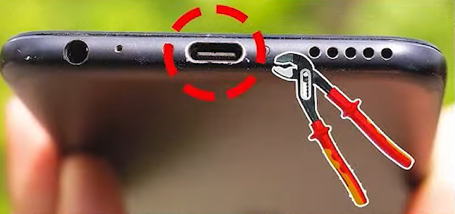

---

## 9. IMEI Verification & Online Carrier Checks

1. **SIM Tray Matching:** Eject the SIM tray and locate the microscopic IMEI number etched into the plastic or metal tray spine. Dial `*#06#` on the phone dialer and confirm the displayed IMEI matches the tray IMEI character-for-character.
2. **Google Official Repair Portal:**
   * Open [Google Store Repair](https://store.google.com/us/repair) in your browser.
   * Enter the phone's IMEI or Serial Number.
   * **Factory Color Match:** Google displays the original manufactured color (e.g., Obsidian, Snow, Hazel, Bay, Porcelain, Lemongrass). Verify this matches the physical color of the phone in your hand. If Google reports "Obsidian" (Black) but you are holding a "Snow" (White) phone, the device has been re-cased with a refurbished or salvaged aftermarket housing.
   * **Carrier Verification (Verizon vs. AT&T):**
     * **Verizon:** If the portal reports "Verizon", walk away immediately if you need bootloader unlocking. Verizon Pixels are permanently hard-locked at the factory level and can never be unlocked, even after being paid off.
     * **AT&T / T-Mobile:** If the portal reports "AT&T", the phone was sold by a carrier. It can be bootloader-unlocked only if it was fully paid off and network-unlocked. You must verify in Developer Options whether the "OEM Unlocking" toggle is active.
   * **Unrecognized Serial:** If Google's database fails to recognize the serial number, the motherboard has been modified or flashed with illegitimate firmware.
3. **Independent Telemetry Portals:**
   * [IMEI Pro](https://www.imeipro.info): Confirms exact marketing model and blacklisted status.
   * [iUnlocker Google Pixel Checker](https://iunlocker.com/check_imei/google-pixel): Verifies warranty expiration, purchase country, and carrier lock status.

---

## 10. PTA & Legal Verification (Pakistan-Specific)

For buyers in Pakistan, ensure the phone is compliant with the Pakistan Telecommunication Authority (PTA):

1. Dial `*#06#` and note down IMEI 1 and IMEI 2.
2. Send each 15-digit IMEI via SMS to `8484` or check on the official [PTA DIRBS Portal](https://dirbs.pta.gov.pk/).
3. Confirm both SIM slots return "Compliant / PTA Approved". Beware of patched phones where only one SIM slot is registered or where software updates will revert approval.

---

## 11. Bootloader Unlock Verification (OEM Unlocking)

A locked bootloader prevents installing custom ROMs, flashing clean factory images, or rooting. Different US carrier variants handle bootloader locking differently:

* **Verizon Variants (Permanent Hard Lock):** Verizon permanently locks the bootloader in hardware and firmware. Even if the phone is fully paid off and unlocked for other SIM cards, the bootloader **can never be unlocked**. Avoid Verizon models completely if you plan to root or install custom ROMs.
* **AT&T & T-Mobile Variants (Conditional Lock):** These variants come locked out of the box while under contract. However, once the phone is fully paid off and carrier-unlocked, connecting to Wi-Fi activates the "OEM Unlocking" toggle. If the toggle is already active on a used AT&T device, it is fully unlockable.
* **Google Store / Unlocked Retail:** The bootloader is unlockable immediately out of the box.

### Checking the Toggle on the Shop Counter

1. Navigate to:
   ```text
   Settings > About phone > Build number
   ```
2. Tap **Build number** 7 times consecutively to enable **Developer options**.
3. Navigate to:
   ```text
   Settings > System > Developer options
   ```
4. Locate the **OEM unlocking** toggle:
   * **Unlocked / Unlockable (Target):** The toggle is active, clickable, and allows you to toggle it on.
   * **Permanently Locked (Walk Away):** If the toggle is greyed out and reads "Connect to the internet or contact your carrier", the phone is carrier-locked (usually Verizon or an unpaid AT&T/SoftBank unit) and cannot be unlocked.

   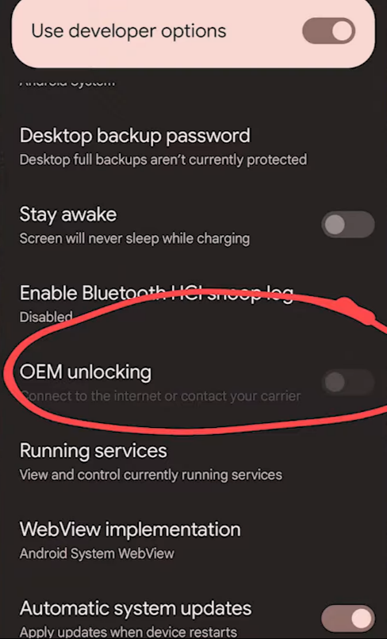

---

## 📱 Google Pixel Hardware Models & Bootloader Compatibility Matrix

Use this reference matrix to confirm the exact model number (found in `Settings > About phone > Regulatory labels` or etched on the back):

### Google Pixel 4
| Model | Region / Carrier | Bootloader Unlockable |
| :--- | :--- | :---: |
| **G020I** | North America (Retail / Unlocked) | ✅ Yes |
| **G020M** | North America (Carrier Dependent) | ✅ Yes |
| **G020N** | Japan (Retail) | ✅ Yes |
| **G020F** | North America (Verizon) | ❌ No |
| **G020J** | Japan (Carrier Locked) | ❌ No |

### Google Pixel 4 XL
| Model | Region / Carrier | Bootloader Unlockable |
| :--- | :--- | :---: |
| **G020** | Global Retail | ✅ Yes |
| **G020P** | Global Retail Variant | ✅ Yes |
| **G020F** | North America (Verizon) | ❌ No |
| **G020J** | Japan (Carrier Locked) | ❌ No |

### Google Pixel 4a
| Model | Region / Carrier | Bootloader Unlockable |
| :--- | :--- | :---: |
| **G025E** | Global Retail | ✅ Yes |
| **G025H** | Australia / Asia Retail | ✅ Yes |
| **G025I** | Japan (Carrier Locked) | ❌ No |
| **G025J** | North America (Verizon) | ❌ No |
| **GA02099** | North America (Verizon) | ❌ No |

### Google Pixel 4a (5G)
| Model | Region / Carrier | Bootloader Unlockable |
| :--- | :--- | :---: |
| **GD1YQ** | USA (Retail Sub-6) | ✅ Yes |
| **G025E** | Global Retail | ✅ Yes |
| **G025H** | Australia / Asia Retail | ✅ Yes |
| **G025I** | Japan (Carrier Locked) | ❌ No |
| **G6QU3** | USA (Verizon mmWave) | ❌ No |

### Google Pixel 5
| Model | Region / Carrier | Bootloader Unlockable |
| :--- | :--- | :---: |
| **GD1YQ** | Global Retail | ✅ Yes |
| **GTT9Q** | USA (Unlocked / Sub-6 Only) | ✅ Yes |
| **GD1YI** | USA (Verizon) | ❌ No |
| **G5NZ6** | Japan Variant (Carrier Locked) | ❌ No |

### Google Pixel 5a (5G)
| Model | Region / Carrier | Bootloader Unlockable |
| :--- | :--- | :---: |
| **G1F8F** | USA / Global Retail | ✅ Yes |
| **G4S1M** | Japan Variant (Carrier Locked) | ❌ No |

### Google Pixel 6
| Model | Region / Carrier | Bootloader Unlockable |
| :--- | :--- | :---: |
| **G9S9B** | Global Retail | ✅ Yes |
| **G9T9B** | Global Retail | ✅ Yes |
| **GR1YH** | USA (Unlocked Google Store) | ✅ Yes |
| **GB7N6** | USA (Verizon) | ❌ No |
| **G9K9B** | Japan (Carrier Locked) | ❌ No |

### Google Pixel 6a
| Model | Region / Carrier | Bootloader Unlockable |
| :--- | :--- | :---: |
| **GH2AE** | Global Retail | ✅ Yes |
| **GX7AS** | Global Retail | ✅ Yes |
| **G1AZG** | Global Retail (EMEA) | ✅ Yes |
| **GB62Z** | USA (Verizon) | ❌ No |
| **GR1YH** | Japan (Carrier Locked) | ❌ No |

### Google Pixel 6 Pro
| Model | Region / Carrier | Bootloader Unlockable |
| :--- | :--- | :---: |
| **GLU0G** | Global Retail | ✅ Yes |
| **G8VOU** | Global Retail (mmWave) | ✅ Yes |
| **GF5KQ** | Japan (Carrier Locked) | ❌ No |

### Google Pixel 7
| Model | Region / Carrier | Bootloader Unlockable |
| :--- | :--- | :---: |
| **GVU6C** | Global Retail | ✅ Yes |
| **GQML3** | USA (Verizon) | ❌ No |
| **GO3Z5** | Japan (Carrier Locked) | ❌ No |

### Google Pixel 7a
| Model | Region / Carrier | Bootloader Unlockable |
| :--- | :--- | :---: |
| **GWKK3** | North America (Retail Sub-6) | ✅ Yes |
| **GHL1X** | Global Retail | ✅ Yes |
| **G82U8** | Japan (Carrier Locked) | ❌ No |
| **G0DZQ** | USA (Verizon mmWave) | ❌ No |

### Google Pixel 7 Pro
| Model | Region / Carrier | Bootloader Unlockable |
| :--- | :--- | :---: |
| **GP4BC** | Global Retail | ✅ Yes |
| **GE2AE** | USA (Verizon) | ❌ No |
| **GFE4J** | Japan (Carrier Locked) | ❌ No |

### Google Pixel 8
| Model | Region / Carrier | Bootloader Unlockable |
| :--- | :--- | :---: |
| **GPJ41** | Global Retail | ✅ Yes |
| **GA04851-US** | USA Retail SKU | ✅ Yes |
| **G9BQD** | USA / Canada Sub-6 GHz | ✅ Yes |
| **GKWS6** | USA (Verizon) | ❌ No |
| **GZPFO** | Japan (Carrier Locked) | ❌ No |

### Google Pixel 8 Pro
| Model | Region / Carrier | Bootloader Unlockable |
| :--- | :--- | :---: |
| **GC3VE** | Global Retail | ✅ Yes |
| **G1MNW** | USA / Canada Retail | ✅ Yes |

---

## 12. Walk-Away Red Flags Summary

Never buy a used mobile device if it exhibits any of the following critical defects:

* **Greyed-Out OEM Unlocking:** Carrier-locked bootloader that cannot be modified or refreshed.
* **Torn Speaker Mesh / Leaking SIM Seal:** Water resistance is completely compromised; phone has been opened.
* **Black Spots on Camera Sensor:** Burned or cracked CMOS sensor pixels.
* **Missing Green Lens Tint:** Replaced low-quality camera cover prone to severe lens flare.
* **Mismatched SIM Tray IMEI:** Re-cased or frankensteined phone assembled from spare parts.
* **Spongy Screen or Rear Glass:** Swollen battery or sloppy aftermarket adhesive jobs.
* **Excessive 4K Video Battery Drain:** Heavily worn battery cells that will require replacement.

---

**Hardware Buying & Maintenance Guides**  
Authored by **M. Hamza** ([@XBEAST1](https://github.com/XBEAST1)). For the latest updates, companion component guides, and contributions, visit the [GitHub Repository](https://github.com/XBEAST1/Hardware-Buying-Guides).

